# Student Registration System

## Introduction
A Laravel-based Student Registration System that lets students register online with validated information and a profile picture. A registration system replaces paper-based forms, keeps records consistent, and is a core feature of enterprise applications such as those used by universities, hospitals, banks, and government agencies. Data validation ensures only correct, complete, and safe data is stored.

## Objectives
- Build HTML forms using Blade templates
- Process client requests using Laravel controllers
- Implement server-side validation
- Display flash messages for success and errors
- Upload and store files using Laravel Storage
- Design a relational table using migrations
- Document the process using Markdown
- Apply Git version control

## Laravel Request Lifecycle
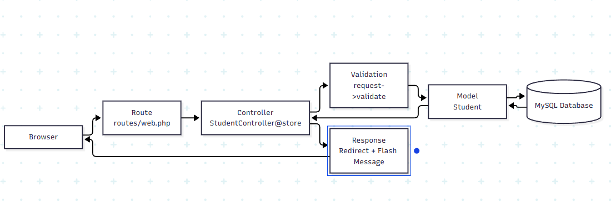

1. The browser submits the form (POST /students).
2. The route in `routes/web.php` maps it to `StudentController@store`.
3. The controller validates the request.
4. If valid, the file is stored and the `Student` model creates the record.
5. The database saves the row.
6. The user is redirected to the profile page with a success flash message.

## Validation Rules
| Rule | Field | Why it matters |
|---|---|---|
| required | student_id, names, email, etc. | Prevents incomplete records |
| unique | student_id, email | Prevents duplicate students |
| email | email | Ensures a valid email format |
| numeric | mobile_number | Rejects letters or symbols |
| image | profile_picture | Accepts only image files |
| mimes:jpg,jpeg,png | profile_picture | Blocks unsafe file types |
| max:2048 | profile_picture | Limits file size to 2MB to protect storage |

## Database Design
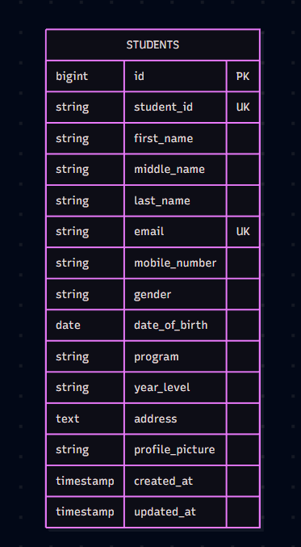

| Column | Type | Constraint |
|---|---|---|
| id | bigint unsigned | Primary key, auto increment |
| student_id | varchar(255) | Unique, required |
| first_name | varchar(100) | Required |
| middle_name | varchar(100) | Nullable |
| last_name | varchar(100) | Required |
| email | varchar(255) | Unique, required |
| mobile_number | varchar(20) | Required |
| gender | varchar(255) | Required |
| date_of_birth | date | Required |
| program | varchar(255) | Required |
| year_level | varchar(255) | Required |
| address | text | Required |
| profile_picture | varchar(255) | Required (file path only) |
| created_at / updated_at | timestamp | Nullable |

## Flowchart
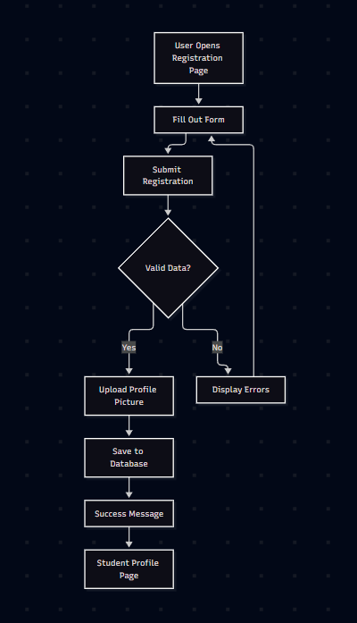

## Screenshots
### Registration Form
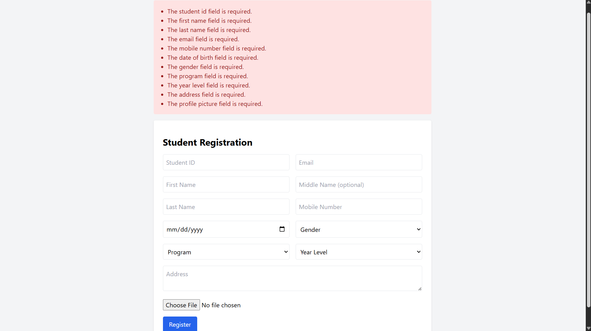
### Validation Errors
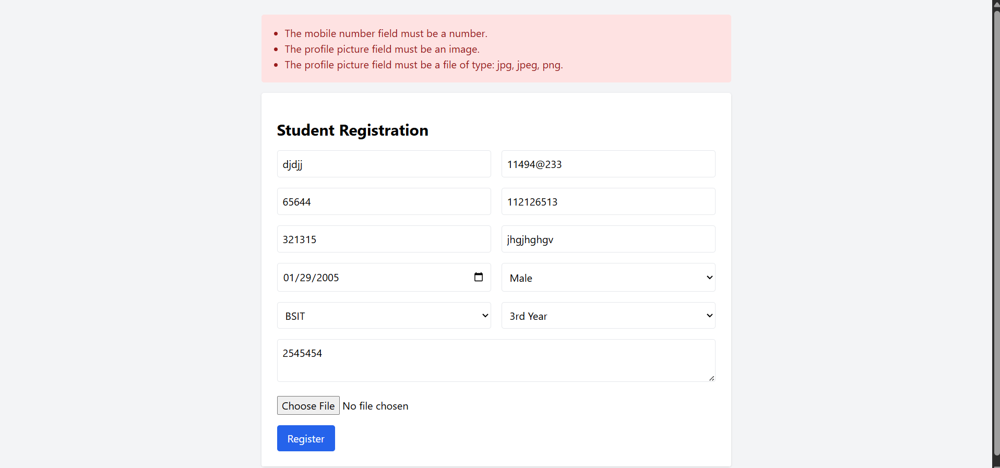
### Duplicate Error
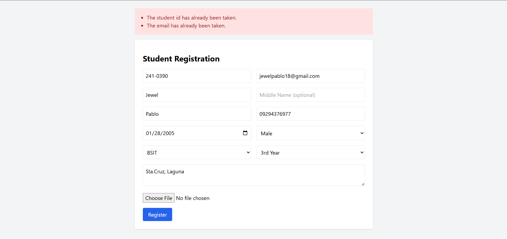
### Flash Message
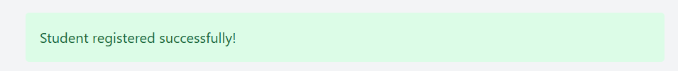
### Uploaded Profile Picture

### Student Profile Page
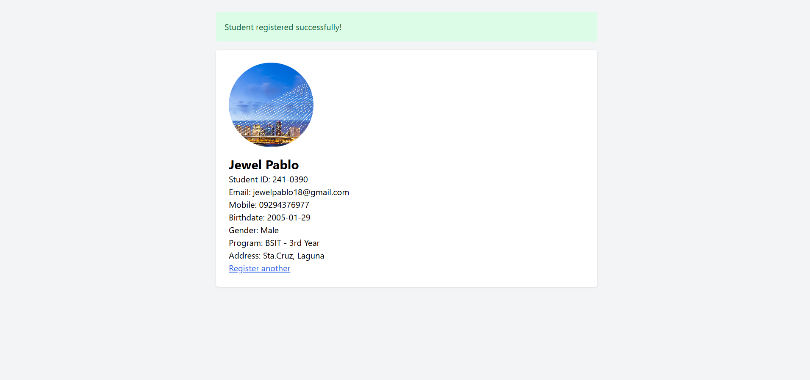
### Database Table
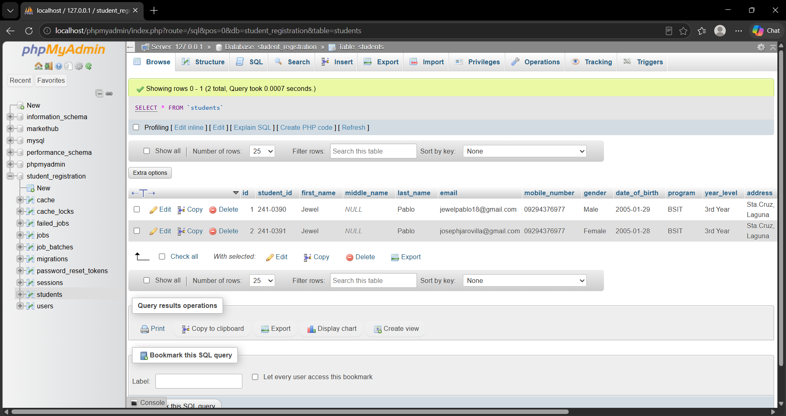
### VS Code Project Structure
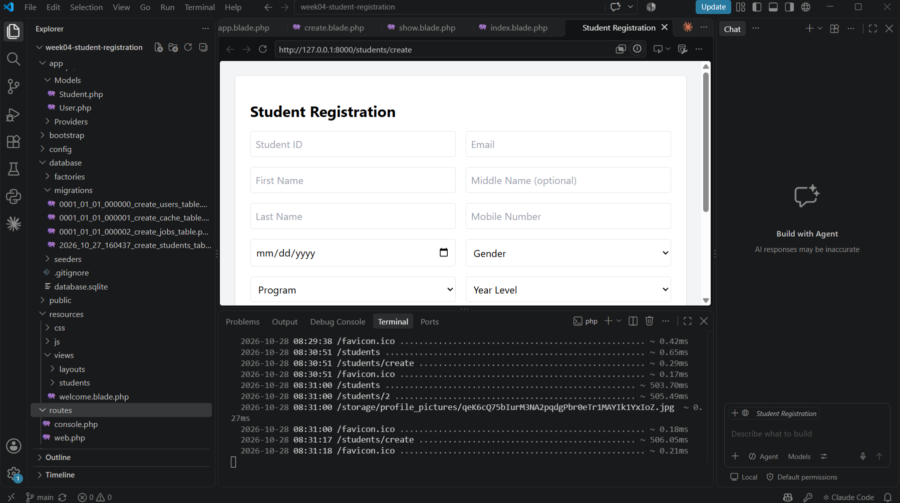
### GitHub Repository
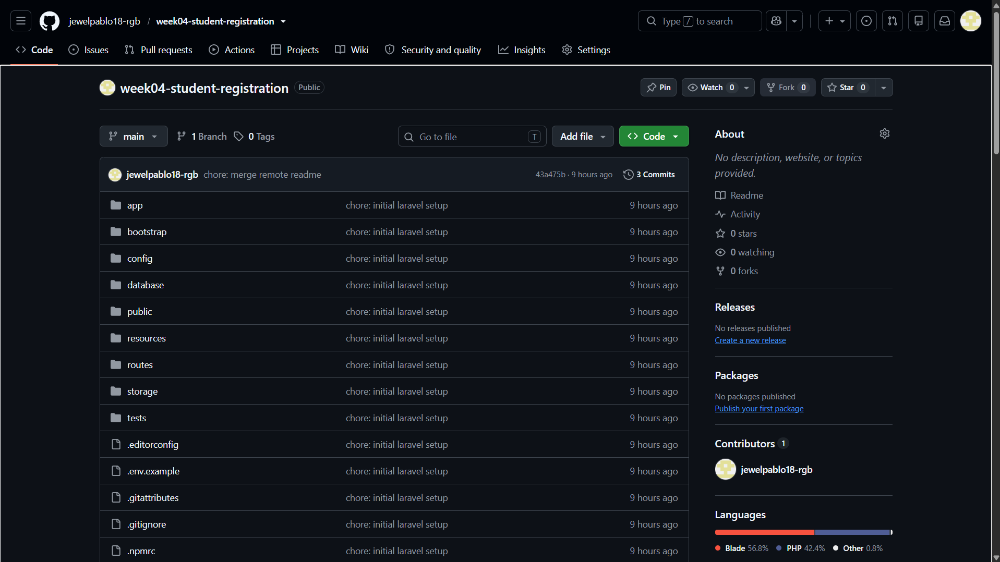
### Terminal Output
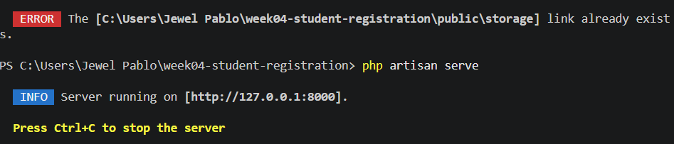
### Browser Output
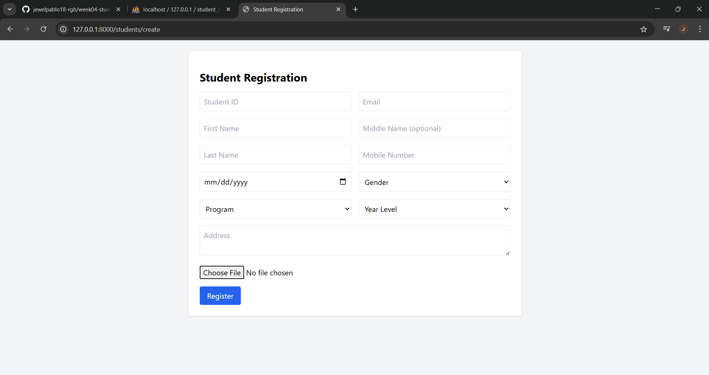

## Problems Encountered
1. Wrong project folder opened (OneDrive ZIP copy), so `.env` changes were not applied.
2. Migration used SQLite instead of MySQL because `.env` was not updated.
3. Blade view not found because the `students` view files were missing or empty.
4. Migration failed because the pasted code did not include the full class structure.

## Solutions
1. Opened the original project folder and edited the correct `.env`.
2. Set `DB_CONNECTION=mysql`, ran `php artisan config:clear`, then `migrate:fresh`.
3. Created the view files in `resources/views/students/` and pasted the code.
4. Replaced the whole migration file with a complete class including `up()` and `down()`.

## Reflection
[Write 500 words here: importance of validation, lessons learned about handling user input, benefits of server-side over client-side validation, importance of file security, and how registration systems are used in real-world enterprise software.]

## References
Laravel. (n.d.). *Laravel documentation*. https://laravel.com/docs

MDN Web Docs. (n.d.). *HTML: Forms*. Mozilla. https://developer.mozilla.org/en-US/docs/Learn/Forms

Oracle. (n.d.). *MySQL documentation*. https://dev.mysql.com/doc/

PHP Documentation Group. (n.d.). *PHP manual*. https://www.php.net/manual/en/

Tailwind Labs. (n.d.). *Tailwind CSS documentation*. https://tailwindcss.com/docs<<<<<<< HEAD
<p align="center"><a href="https://laravel.com" target="_blank"></a></p>

<p align="center">
<a href="https://github.com/laravel/framework/actions"></a>
<a href="https://packagist.org/packages/laravel/framework"></a>
<a href="https://packagist.org/packages/laravel/framework"></a>
<a href="https://packagist.org/packages/laravel/framework"></a>
</p>

## About Laravel

Laravel is a web application framework with expressive, elegant syntax. We believe development must be an enjoyable and creative experience to be truly fulfilling. Laravel takes the pain out of development by easing common tasks used in many web projects, such as:

- [Simple, fast routing engine](https://laravel.com/docs/routing).
- [Powerful dependency injection container](https://laravel.com/docs/container).
- Multiple back-ends for [session](https://laravel.com/docs/session) and [cache](https://laravel.com/docs/cache) storage.
- Expressive, intuitive [database ORM](https://laravel.com/docs/eloquent).
- Database agnostic [schema migrations](https://laravel.com/docs/migrations).
- [Robust background job processing](https://laravel.com/docs/queues).
- [Real-time event broadcasting](https://laravel.com/docs/broadcasting).

Laravel is accessible, powerful, and provides tools required for large, robust applications.

## Learning Laravel

Laravel has the most extensive and thorough [documentation](https://laravel.com/docs) and video tutorial library of all modern web application frameworks, making it a breeze to get started with the framework.

In addition, [Laracasts](https://laracasts.com) contains thousands of video tutorials on a range of topics including Laravel, modern PHP, unit testing, and JavaScript. Boost your skills by digging into our comprehensive video library.

You can also watch bite-sized lessons with real-world projects on [Laravel Learn](https://laravel.com/learn), where you will be guided through building a Laravel application from scratch while learning PHP fundamentals.

## Agentic Development

Laravel's predictable structure and conventions make it ideal for AI coding agents like Claude Code, Cursor, and GitHub Copilot. Install [Laravel Boost](https://laravel.com/docs/ai) to supercharge your AI workflow:

```bash
composer require laravel/boost --dev

php artisan boost:install
```

Boost provides your agent 15+ tools and skills that help agents build Laravel applications while following best practices.

## Contributing

Thank you for considering contributing to the Laravel framework! The contribution guide can be found in the [Laravel documentation](https://laravel.com/docs/contributions).

## Code of Conduct

In order to ensure that the Laravel community is welcoming to all, please review and abide by the [Code of Conduct](https://laravel.com/docs/contributions#code-of-conduct).

## Security Vulnerabilities

If you discover a security vulnerability within Laravel, please send an e-mail to Taylor Otwell via [taylor@laravel.com](mailto:taylor@laravel.com). All security vulnerabilities will be promptly addressed.

## License

The Laravel framework is open-sourced software licensed under the [MIT license](https://opensource.org/licenses/MIT).
=======
# week04-student-registration
>>>>>>> 97cddf284d80e13348f5f6005a3cee4514d1a1cb
